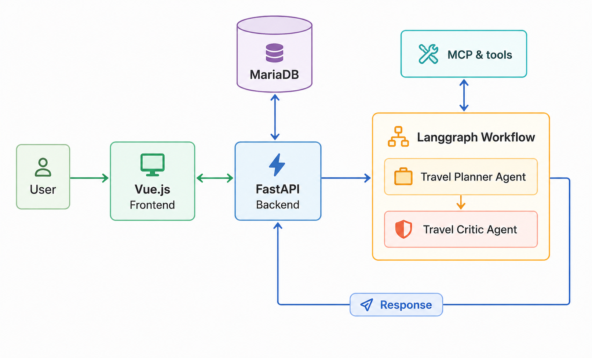

# Travel Intelligence Agent — Architecture

## 1. Overview

Travel Intelligence Agent is an AI-powered travel research and planning
assistant.

The system helps users find and plan trips based on their personal preferences,
constraints, and objectives. Instead of simply generating an itinerary, the
agent researches real-world travel options, compares alternatives, validates
constraints, and replans when necessary.

The system is built around **LangGraph** for agent orchestration and
**Model Context Protocol (MCP)** for accessing external travel capabilities.

---

## 2. Problem

Planning a trip requires combining information from multiple sources:

- Flights
- Accommodation
- Transportation
- Weather
- Activities
- Destinations

Current travel platforms are good at searching individual components, but
users still have to manually combine this information and determine which
option best fits their specific constraints.

The goal is to provide a single agentic system capable of performing this
research and producing a coherent, personalized travel plan.

---

## 3. Goals

- Understand natural-language travel requirements.
- Research and compare multiple destinations.
- Use real-world travel data through MCP tools.
- Respect user constraints such as budget, dates and transportation.
- Generate personalized itineraries.
- Validate proposed plans before presenting them.
- Replan when constraints cannot be satisfied.
- Provide evidence for important recommendations.
- Maintain travel-planning state across interactions.

---

## 4. Example User Interaction

**User**

> I want to travel for 10 days in September with my partner, leaving from
> Madrid. Our budget is €2,500. We like hiking and nature, want to avoid very
> touristy places, and don't want to rent a car.

**Agent**

> I've compared 12 destinations. My top recommendation is Madeira (91/100).
>
> Estimated cost: €2,180
>
> Why:
> - Excellent hiking opportunities
> - Suitable September weather
> - Fits your budget
> - Possible to travel without renting a car
>
> Main drawback: some hiking areas have limited public transport.
>
> I can now build a 10-day itinerary for Madeira.

The user can then modify the requirements:

> What if we increase the budget to €3,000?

The system updates the existing state and replans instead of starting from
scratch.

---

## 5. High-Level Architecture




---

## 6. Agents

### Travel Planner Agent

The main agent responsible for understanding the user's requirements,
selecting the most suitable destination, coordinating travel research, and
building the final travel plan.

It can:

- Interpret user preferences and constraints.
- Identify and compare candidate destinations.
- Decide which information needs to be researched.
- Combine flight, accommodation, activity, and transportation options.
- Build and optimize the travel plan.
- Trigger replanning when the current plan does not satisfy the requirements.

The agent uses external capabilities through MCP tools and does not directly
handle provider-specific integrations.

### Travel Critic Agent

Reviews the proposed travel plan before it is presented to the user.

It evaluates:

- User requirements and preferences.
- Budget and estimated total cost.
- Dates and trip duration.
- Transportation feasibility.
- Consistency of the itinerary.
- Unsupported or potentially unreliable recommendations.

The critic returns a structured decision indicating whether the plan is valid
or requires replanning.

---

## 7. LangGraph Workflow

LangGraph orchestrates the complete planning process and manages the shared
state between the agents, tools, and deterministic components.

The main workflow is:

```text
User Request
     │
     ▼
Travel Planner Agent
     │
     │ Select destination
     ▼
Destination Research
     │
     ├──────────┬───────────┬────────────┐
     ▼          ▼           ▼            ▼
  Flights     Hotels    Activities   Transport
     │          │           │            │
     └──────────┴───────────┴────────────┘
                       │
                       ▼
                  Plan Builder
                    + Budget
                       │
                       ▼
              Travel Critic Agent
                       │
                 ┌─────┴─────┐
                 │           │
               Valid       Invalid
                 │           │
                 ▼           ▼
           Final Response   Replan
                             │
                             ▼
                    Travel Planner Agent
                             │
                             └──► Research
```

If the critic determines that the plan does not satisfy the user's
requirements, LangGraph routes execution back to the Travel Planner Agent,
which can modify the plan and repeat the necessary research.

The number of replanning attempts is bounded to prevent uncontrolled loops.

LangGraph is responsible for workflow orchestration, shared state,
parallel execution, conditional routing, and replanning.

---

## 8. Tools & MCP

The system uses **MCP for external travel capabilities** and custom tools for
internal deterministic logic.

### External MCPs

#### [Weather MCP](https://github.com/weather-mcp/weather-mcp)

Provides weather information used to evaluate destinations and build
weather-aware itineraries.

Main capabilities:

* Weather forecasts
* Historical weather
* Location search

#### [trvl MCP](https://github.com/MikkoParkkola/trvl)

Provides travel search capabilities across multiple transportation and
accommodation categories.

Main capabilities:

* Flights
* Hotels
* Trains
* Buses
* Ferries
* Rental cars

#### [TicketLens MCP](https://github.com/ticketlens/ticketlens-experiences-mcp)

Provides activity and ticket information for destinations.

Main capabilities:

* Search activities
* Search attractions and experiences
* Retrieve activity details

---

### Custom MCP

#### Maps MCP

A custom MCP server developed specifically for the project.

It provides:

* Geocoding
* Place search
* Route calculation
* Distance calculation
* Travel-time estimation

The MCP will use open geographic data and routing services such as
**OpenStreetMap/Nominatim** and **OSRM**.

---

### Custom Tools

Some capabilities do not require MCP and will be implemented as regular
application tools or deterministic code:

* `calculate_budget()` — calculates the estimated total trip cost.
* `validate_constraints()` — checks hard constraints such as budget, dates,
  duration, and transportation requirements.
* `calculate_trip_score()` — evaluates candidate plans according to the user's
  preferences and requirements.

The distinction is intentional: **MCP is used for external capabilities that
benefit from a standardized tool interface, while internal business logic is
implemented directly as application tools.**

---

## 9. Persistence

**MariaDB** will store application data such as:

- Users
- Travel sessions
- Travel requirements
- Research results
- Evidence
- Itineraries

**LangGraph checkpointing** will be used to persist graph execution state,
allowing conversations and travel-planning workflows to continue across
interactions.

Application data and LangGraph execution state will be treated as separate
concerns.

---

## 10. Web Application

The application will use **Vue.js** for the frontend and **FastAPI** for the
backend API.

The web application will provide:

- **Chat** — interact with the travel agent.
- **Destination comparison** — compare recommended destinations.
- **Interactive map** — visualize destinations, activities, and routes.
- **Itinerary** — view the generated trip day by day.
- **Budget** — visualize estimated costs.
- **Evidence** — inspect the sources behind important recommendations.

FastAPI will act as the main backend API between the Vue.js frontend and the
agentic system, while LangGraph manages the travel-planning workflow.

---

## 11. Observability

The system will use **LangSmith** to monitor and debug agent executions.

Tracked information will include:

* LangGraph runs
* Node execution
* MCP/tool calls
* Errors
* Latency
* Token usage
* Estimated cost

---

## 12. Evaluation

The system will include a reproducible evaluation dataset containing realistic
travel requests and constraints.

Key metrics:

* **Constraint satisfaction** — does the plan respect user requirements?
* **Recommendation quality** — are destinations relevant?
* **Groundedness** — are important claims supported by retrieved data?
* **Replanning success** — can the agent recover from an invalid plan?
* **Tool efficiency** — does the agent use tools appropriately?
* **Latency and cost** — how expensive and slow is a planning session?

---

## 13. Development Phases

### Phase 1 — Initial Travel Agent
- Build a simple LLM-based Travel Planner.
- Define system prompt, personality, tone, and response format.
- Test with realistic travel scenarios.

### Phase 2 — Structured Travel State
- Define the shared `TravelState`.
- Extract and maintain structured user requirements.
- Update the `TravelState` accross interactions.

### Phase 3 — External Capabilities
- Integrate Weather MCP.
- Build the custom Maps MCP.
- Integrate trvl MCP.
- Integrate TicketLens MCP.
- Evaluate the impact of external data on recommendations.

### Phase 4 — Destination Research
- Implement candidate destination generation.
- Research and compare destinations.
- Select the most suitable destination.

### Phase 5 — Parallel Trip Research
- Research flights, hotels, activities, and transportation in parallel.
- Combine research results into a unified trip context.

### Phase 6 — Plan & Budget
- Generate the complete itinerary.
- Implement deterministic budget calculation.
- Implement constraint validation and trip scoring.

### Phase 7 — Critic & Replanning
- Introduce the Travel Critic Agent.
- Add conditional routing and replanning loops.
- Implement bounded retry/replanning logic.

### Phase 8 — Persistence & Web Application
- Add MariaDB persistence.
- Add LangGraph checkpointing.
- Build the FastAPI backend.
- Build the Vue.js frontend.

### Phase 9 — Observability & Evaluation
- Integrate LangSmith.
- Build an evaluation dataset.
- Measure constraint satisfaction, groundedness,
  recommendation quality, and replanning success.

### Phase 10 — Polish & Release
- Improve documentation and architecture diagrams.
- Add tests and deployment configuration.
- Publish the project with a reproducible setup and demo.

