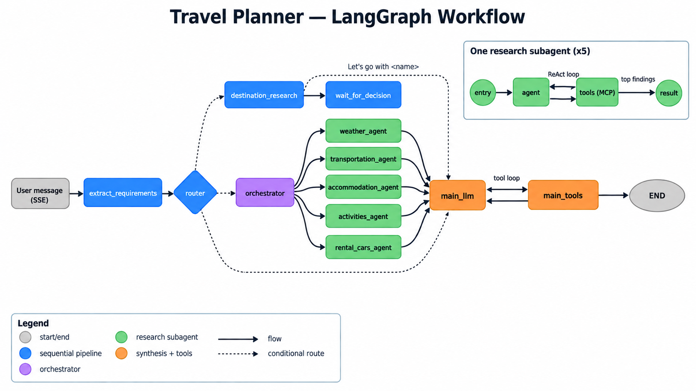

# Agentic Travel Planning System — Architecture

- [1. Overview](#1-overview)
- [2. Problem](#2-problem)
- [3. Goals](#3-goals)
- [4. LangGraph Workflow](#4-langgraph-workflow)
- [5. Human-in-the-Loop Protocol](#5-human-in-the-loop-protocol)
- [6. Tools & MCP](#6-tools--mcp)
- [7. Persistence](#7-persistence)
- [8. Web Application](#8-web-application)
- [9. Observability](#9-observability)
- [10. Evaluation](#10-evaluation)
- [11. Project Structure](#11-project-structure)
- [12. Development Phases](#12-development-phases)

## 1. Overview

Agentic Travel Planning System is a chat-first, multi-agent travel planner. Users describe trips in natural language; the system extracts structured requirements, compares candidate destinations, researches flights, accommodation, activities, weather, and rental cars in parallel through MCP tools, and assembles a trip plan from priced options the user picks, with deterministic budget tracking.

Its defining properties:

- Human-in-the-loop: destinations and plan options are chosen in the UI, never guessed by the model (see [§5 Human-in-the-Loop Protocol](#5-human-in-the-loop-protocol)).
- Deterministic plan edits: choices are persisted server-side with snapshotted prices; the LLM only confirms them (see [§5 Human-in-the-Loop Protocol](#5-human-in-the-loop-protocol) and [§6 Tools & MCP](#6-tools--mcp)).
- Cost-engineered: tiered cheap models, Jev decision routing, capped token budgets, and per-turn cost stats.
- Persistent: conversations, saved plans, and graph checkpoints survive backend restarts in SQLite (see [§7 Persistence](#7-persistence)).

The system is built around **LangGraph** for agent orchestration and **Model Context Protocol (MCP)** for accessing external travel capabilities.

## 2. Problem

Planning a trip requires combining information from multiple sources:

- Flights
- Accommodation
- Transportation
- Weather
- Activities
- Destinations

Current travel platforms are good at searching individual components, but users still have to manually combine this information and determine which option best fits their specific constraints.

The goal is to provide a single agentic system capable of performing this research and producing a coherent, personalized travel plan.

## 3. Goals

- Understand natural-language travel requirements.
- Research and compare multiple destinations.
- Use real-world travel data through MCP tools.
- Respect user constraints such as budget, dates and transportation.
- Generate personalized itineraries.
- Let the user validate plans by picking from priced options.
- Replan from updated requirements without starting over.
- Show the research behind recommendations.
- Maintain travel-planning state across interactions.

## 4. LangGraph Workflow

LangGraph orchestrates the planning process around one shared object, the `TravelState` (`agents/state.py`): a TypedDict every node reads and partially updates. Its channels: `messages` (append-only conversation); `requirements` (structured `TravelRequirements`, or `None` before extraction); `next_step` (the router's decision); `destination_candidates` (scored shortlist); `orchestration_plan` (which subagents run); one append-only result channel per research agent; `available_options` (selectable options per category, merged per group so parallel publishes never overwrite each other); `trip_plan` (saved choices with snapshotted prices); `turn_usage` (one cost entry per LLM call in the turn).

The figure below shows the full topology as implemented: the left-to-right main flow (blue sequential pipeline, purple orchestration, green research fan-out, orange synthesis) plus one research subagent expanded on the right.



Notes:

- `orchestrator` fans out to research **subgraphs** (weather, transportation, accommodation, activities, rental cars), each a ReAct loop over its MCP tools. They register dynamically — only agents with working tools exist.
- `thread_id = conversation_id`: one checkpointer key per conversation, so turns resume state across interactions and restarts.
- Destination pick pauses via `interrupt()` in `wait_for_decision` and resumes on the next user turn (see [§5 Human-in-the-Loop Protocol](#5-human-in-the-loop-protocol)).
- Saved-choices confirmations skip `extract` + `router` and go straight to `main_llm` (see [§5 Human-in-the-Loop Protocol](#5-human-in-the-loop-protocol)).
- Tool exceptions are caught (`_guard_tool`) so a failing MCP call becomes text the subagent reports instead of killing the stream.

### Nodes

- **extract_requirements** — parses the user message into structured `TravelRequirements` (minimal-reasoning LLM, structured output). Runs first every turn except saved-choices confirmations.
- **router** — picks the next route via a Jev decision call, with a light-LLM structured-output fallback on error or low confidence: `main_llm` for chit-chat, off-topic, or questions answerable from state; `destination_research` when no destination is settled and the user wants ideas/comparison; `orchestrator` only when concrete bookable options are explicitly requested.
- **destination_research** — builds and scores a shortlist of candidate destinations from requirements + live data.
- **wait_for_decision** — pauses with `interrupt()` until the user picks. The pick happens on UI buttons (destination carousel): clicking injects a user message `Let's go with <name>` so the turn resumes to `main_llm` with the choice in context; any other text goes back to `extract`.
- **orchestrator** — from the user's requirements, decides which research subagents the request needs and fans out to them in parallel. Only agents with loaded MCP tools are offered (`AVAILABLE_AGENTS`).
- **Research subagents** (weather, transportation, accommodation, activities, rental cars) — one ReAct loop each over its MCP tools with the minimal-reasoning model; each returns its top findings into shared state.
- **main_llm (+ main_tools)** — synthesizes research into the reply and calls the plan tools (`present_options`, `add/remove_plan_item`) as needed. Its tokens are the only ones streamed live; subagent findings arrive separately as completed accordion blocks (`agent.result` events).

## 5. Human-in-the-Loop Protocol

The agent proposes options, the user picks — via two machine-readable message protocols:

- **Destination pick.** After `destination_research` presents the shortlist as a carousel, the user picks one on the UI buttons. Clicking sends `Let's go with <name>` (`CHOOSE_PREFIX` in `agents/nodes/destinations.py`); anything else re-enters extract → research.
- **Choice save.** After the subagents present their findings, each category's alternatives (e.g. different flight options) render as selectable cards. `POST /choices` persists the selected option_ids against live `available_options` deterministically, then the frontend sends `I'll go with:` plus one `- Category: label` line per pick (`SAVED_CHOICES_PREFIX` in `agents/tools/plan.py`). Single-choice categories (transportation, accommodation, rental_car) replace the previous pick within the same group; activities accumulate. New searches overwrite `available_options` but never touch `trip_plan`.

Because prices are snapshotted server-side at save time, the LLM only confirms choices — it never invents prices.

## 6. Tools & MCP

The system uses **MCP for external travel capabilities** and custom tools for internal deterministic logic.

### External MCPs

#### [Weather MCP](https://github.com/weather-mcp/weather-mcp)

Provides weather information used to evaluate destinations and build weather-aware itineraries.

Main capabilities:

* Weather forecasts
* Historical weather
* Location search

#### [trvl CLI](https://github.com/MikkoParkkola/trvl)

Exposes a **single `travel` router tool** (`query` / `intent` / `params`): `search_flights` and the remaining intents are values, not separate tools — this keeps the LLM tool surface small and stable.

Main capabilities:

* Flights
* Accommodation (prefers lean `search_accommodations`; `search_hotels` only as fallback — see Known Issues in the README)
* Trains
* Buses
* Ferries

#### [TicketLens MCP](https://github.com/ticketlens/ticketlens-experiences-mcp)

Provides activity and ticket information for destinations.

Main capabilities:

* Search activities
* Search attractions and experiences
* Retrieve activity details

#### [OctoTrip Rental Cars MCP](https://github.com/OctoTrip/rental-cars)

Provides rental car information for destinations.

Main capabilities:

* Search rental cars
* Compare rental offers and prices

### Application tools (deterministic)

Capabilities that must not depend on LLM judgment are plain tools / code, so prices and totals are computed, never generated:

* `present_options` — publishes one category's selectable options (with per-leg `group`s) for the UI to render.
* `add_plan_item` / `remove_plan_item` — snapshot label/price into `trip_plan` (single-choice replace vs. activities accumulate).
* `update_requirements` — structured requirement edits from chat.
* `plan_total()` — trip total: per-person prices × travelers, most common currency wins (no FX conversion).

The distinction is intentional: **MCP is used for external capabilities that benefit from a standardized tool interface, while internal business logic is implemented directly as application tools.**

## 7. Persistence

**SQLite** stores application data such as:

- Travel sessions (conversations)
- Message history
- Travel requirements (via graph checkpoints)
- Research results (via graph checkpoints)
- Itineraries (trip plan snapshots)

**LangGraph checkpointing** (`AsyncSqliteSaver`, `checkpoints.db`) persists graph execution state, allowing conversations and travel-planning workflows to continue across interactions **and backend restarts** (`thread_id = conversation_id`).

Application data (`app.db`: `conversations`, `messages`) and LangGraph execution state (`checkpoints.db`) are separate concerns — and separate files. Both go through a single `DATABASE_URL`-style configuration (`DATABASE_URL` / `CHECKPOINT_DB_URL`) so a future move to Postgres is a config change, not a code change.

## 8. Web Application

The application uses **Vue 3 + PrimeVue + Pinia** for the frontend and **FastAPI** for the backend API, connected by REST plus an SSE turn stream (`api/v1/streaming.py`).

The web application provides:

- **Chat** — multi-turn planning with live per-agent status and token streaming.
- **Destination comparison** — candidate carousel with scored recommendations; one click sends the pick (`Let's go with …`).
- **Priced options UI** — per-category choice controls bound to `available_options`; picks save via `POST /choices`.
- **Trip plan + budget** — timeline sidebar with running total vs. budget and per-turn cost stats under each reply.
- **Plans library** — saved trips persisted in SQLite, revisit later.

FastAPI is the only gateway between the Vue frontend and the agentic system; LangGraph manages the travel-planning workflow.

### API Contract

Paths relative to `/api/v1`:

| Method | Path | Purpose |
|---|---|---|
| `GET` | `/conversations` | List conversations (sidebar). |
| `POST` | `/conversations` | Create a conversation. |
| `GET` | `/conversations/{id}/messages` | Message history. |
| `GET` | `/conversations/{id}/state` | Rehydrate client state (requirements, research, plan). |
| `PATCH` | `/conversations/{id}` | Rename (title). |
| `DELETE` | `/conversations/{id}` | Delete with messages. |
| `POST` | `/conversations/{id}/messages` | Send a message; streams the turn as SSE (see below). |
| `POST` | `/conversations/{id}/choices` | Deterministic choice save; returns saved labels + refreshed plan. |
| `POST` | `/conversations/{id}/plans` | Snapshot the current trip plan into the library. |
| `GET` | `/plans` | List saved plans. |
| `GET` | `/plans/{plan_id}` | Plan detail. |
| `PATCH` | `/plans/{plan_id}` | Rename a saved plan. |
| `DELETE` | `/plans/{plan_id}` | Delete a saved plan. |

### SSE Events

`POST …/messages` streams one turn as `StreamEvent` frames (`frontend/src/types/index.ts`), ending with `done`:

| Event | Carries |
|---|---|
| `status` | Phase text while the turn runs. |
| `agents.start` / `agent.done` | Live subagent rows (start / finish). |
| `agent.result` | One subagent's completed findings (accordion block). |
| `research.update` | Per-category research state (`pending` / `active` / `done`). |
| `requirements.updated` | Structured requirements for the side panel. |
| `options` | Priced options of one category (choice controls). |
| `plan.updated` | Trip plan + deterministic total. |
| `token` | Live text tokens — `main_llm` only. |
| `message` | Final assistant message object. |
| `stats` | Turn usage: tokens in/out, `cost_usd`, duration. |
| `title.updated` | Auto-generated conversation title. |
| `done` / `error` | End of stream / friendly failure (e.g. rate limit). |

## 9. Observability

The system uses **LangSmith** (traces, node runs, tool calls) plus per-turn usage accounting:

* LangGraph runs
* Node execution
* MCP/tool calls
* Errors
* Latency
* Token usage
* Estimated cost (`cost_usd`, authoritative OpenRouter pricing)

On top of tracing, each turn folds its `turn_usage` slice into a `stats` event streamed to the UI (tokens in/out, cost, duration) — cost control is visible, not theoretical.

## 10. Evaluation

> Status: pending — the dataset below exists and is used for manual spot-checks, but automated scoring is not implemented yet.

Evaluation is dataset-first (`src/backend/evals/dataset.jsonl`): 50 realistic travel requests with expected outcomes. A simulator harness that drives multi-turn conversations plus a Jev-as-judge scorer are planned (see Future Work in the README) — deliberately no LangSmith dependency at eval time, so iteration stays a local pytest run while the judge questions are calibrated.

Key metrics:

* **Constraint satisfaction** — does the plan respect user requirements?
* **Recommendation quality** — are destinations relevant?
* **Groundedness** — are important claims supported by retrieved data?
* **Recovery success** — can the agent replan from changed requirements?
* **Tool efficiency** — does the agent use tools appropriately?
* **Latency and cost** — how expensive and slow is a planning session?

### Evaluation dataset (`src/backend/evals/dataset.jsonl`)

One JSON object per line, 50 cases (`eval-001`…`eval-050`, prompts in English). Each line has this structure:

| Field | Type | Description |
|---|---|---|
| `id` | string | Stable case id, for referencing in runs and scores. |
| `prompt` | string | Initial user message, written as a realistic user would. |
| `personality` | string | Hidden user profile shown **only** to the simulator LLM (never to the system): latent preferences for intermediate decisions, and mid-conversation changes (destination/duration/budget switches) where applicable. |
| `expected.destination` | string \| null | Fixed destination, or `null` for open cases that must go through `destination_research`. |
| `expected.budget` | number \| null | Total budget cap, or `null` when the case sets none. |
| `expected.currency` | string \| null | Budget currency (or `null` together with budget). |
| `expected.travelers` | number \| null | Party size, or `null` when unspecified. |
| `expected.dates` | string \| null | Dates/duration in free text. |
| `expected.must_satisfy` | string[] | 2–5 atomic, checkable conditions (one fact each) against the final `requirements` + `trip_plan`. The future Jev judge would ask one yes/no question per condition. `expected` always reflects the **final** state after any mid-conversation change, not the initial prompt. |

### Case coverage groups

| IDs | Group | What it exercises |
|---|---|---|
| `eval-001`–`eval-010` | Fixed destination + dates + budget | Direct `orchestrator` path: couples, families, solo, business, anniversary, ski, accessibility needs. |
| `eval-011`–`eval-020` | Open destination | `destination_research` + user decision: beach, museums, hiking, romance, auroras, surf, budget escape, teens, digital nomad, foodie. |
| `eval-021`–`eval-026` | Indecision between 2–3 destinations | Comparison + `CHOOSE_PREFIX` resume path. |
| `eval-027`–`eval-032` | Mid-conversation change of mind | Re-entry into `extract` (replanning): destination switch, shorter/longer trip, dropped budget, injury, extra traveler, extended stay. |
| `eval-033`–`eval-037` | Tight or impossible budget | System honesty: luxury on an unworkable budget, absurd requests, plus realistic backpacker cases. |
| `eval-038`–`eval-042` | Groups and families | Party-size math (`per_person` × N): villa for 6, two families, kids, grandparents, surf camp. |
| `eval-043`–`eval-046` | Single category | Partial subagent use: activities only, transport only, accommodation only, day trip without overnight stay. |
| `eval-047`–`eval-050` | Adversarial / edge cases | Past dates, fictional destination, near-empty prompt (must ask, not guess), last-minute full booking. |

## 11. Project Structure

```text
src/
  backend/app/
    agents/       # graph.py, state.py, nodes/, subagents/, tools/, ai_models/, mcp/, usage.py
    api/          # FastAPI router + v1 (conversations, plans, streaming, schemas…)
    database/     # engine, models, repositories, checkpointer (AsyncSqliteSaver)
    evals/        # evaluation dataset (dataset.jsonl)
    main.py       # lifespan: init DB → load MCP tools → build one shared graph
  frontend/src/
    views/        # ChatView, ConversationsView, PlansView, PlanDetailView
    components/   # chat/, layout/, sidebar/, travel-state/
    stores/       # travel.ts (chat state) + travelEvents.ts (SSE translator) + library/ui
    api/          # REST client, SSE stream, travelService gateway
    router/ types/ utils/ composables/
notebooks/        # legacy phase 1–5 prototype (superseded by src/)
docs/architecture.md
docker-compose.yml  # backend :8000 + frontend :8080, backend-data volume
```

| Path | Purpose |
|---|---|
| `agents/graph.py` | Wires nodes + conditional edges and compiles the shared app. No node logic lives here. |
| `agents/state.py` | `TravelState` schema, plan/option models, reducers (per-category and per-group merge). |
| `agents/nodes/` | One module per graph node: extract, router, destination research + decision wait, orchestrator, main LLM. |
| `agents/subagents/` | One ReAct subgraph per research specialty; `_base.py` holds the shared loop. |
| `agents/tools/` | LLM-callable plan/requirement tools (`plan.py`, `requirements.py`) — deterministic by design. |
| `agents/ai_models/` | Model tiers (`llm.py`) and Jev decision routing (`jev.py`). |
| `agents/mcp/` | Server registry + best-effort loader; unreachable servers are skipped, never fatal. |
| `agents/usage.py` | Token/cost accounting per message, aggregated into the turn `stats` event. |
| `api/v1/streaming.py` | Runs one graph turn and translates node updates into SSE events for the UI. |
| `api/v1/conversations.py` + `plans.py` | REST endpoints: conversations/messages, deterministic `POST /choices`, saved plans, titles. |
| `database/` | SQLite engine + models (`conversations`, `messages`), CRUD helpers, LangGraph checkpointer. |
| `views/` | One route per screen: active trip chat, conversation history, saved-plans library + detail. |
| `components/chat/` | Message list, composer, destination carousel, priced-option controls, subagent accordions. |
| `stores/travel.ts` | Client chat state: messages, requirements, options, plan, budget. |
| `stores/travelEvents.ts` | Translates the 14 SSE event types into store updates (owns per-turn buffers). |
| `api/travelService.ts` | The only gateway to the backend; every REST/SSE call goes through it. |

## 12. Development Phases

This section records the development plan and the phases the project has gone through, in order — what was built at each step and what is still open. Checked items are done; unchecked items are pending or deliberately dropped (noted as such).

### Phase 1 — Initial Travel Agent

- [x] Create the basic LLM chat loop
- [x] Add the initial system prompt
- [x] Refine the Travel Planner's personality and tone
- [x] Test and refine the agent with realistic travel scenarios

### Phase 2 — Structured Travel State

- [x] Define the initial `TravelState`
- [x] Make the Travel Planner produce structured requirements
- [x] Store the structured requirements in the graph state
- [x] Add LangGraph checkpointing
- [x] Verify that travel state persists across interactions
- [x] Verify that travel state updates when needed

### Phase 3 — External Capabilities

- [x] Integrate the Weather MCP into the existing graph
- [x] Use weather data in destination recommendations
- [x] Integrate the trvl CLI (single `travel` router tool)
- [x] Use real travel data in the planning process
- [x] Integrate the TicketLens MCP
- [x] Use activity data in destination recommendations
- [x] Integrate the OctoTrip Rental Cars MCP
- [x] Use rental car data in destination recommendations
- [ ] Custom Maps MCP — dropped, trvl + TicketLens cover the need

### Phase 4 — Destination Research

- [x] Add an initial requirements extraction node
- [x] Add router node for deciding whether destination research is needed
- [x] Generate a shortlist of candidate destinations
- [x] Score and compare candidate destinations
- [x] Let the user pick one (`interrupt` / resume, `Let's go with …`)

### Phase 5 — Parallel Multi-Agent Research

- [x] Orchestrate specialized travel-research subagents and execute them in parallel
- [x] Implement iterative MCP tool use within each subagent and store their results in the shared state
- [x] Pass the available research results to the main LLM for final synthesis

### Phase 6 — Plan & Budget

- [x] Define the structured travel-plan representation
- [x] Generate a complete plan from the research results
- [x] Add deterministic budget calculation (`plan_total`)
- [ ] Constraint validation / trip scoring — dropped, covered by human-in-the-loop instead (user picks from priced options)

### Phase 7 — Conversational Web Prototype

- [x] Create initial frontend prototype (Vue 3 + PrimeVue + Pinia)
- [x] Expose the LangGraph workflow through a minimal web interface
- [x] Build the conversational chat interface
- [x] Support multi-turn conversations and LangGraph interrupts/resume
- [x] Display subagents responses as complementary info
- [x] Support thread-based conversations
- [x] Display current travel requirements and planning state
- [x] Let users pick research options in the chat (human-in-the-loop implementation)
- [x] Display trip plan and budget information
- [x] Allow saving the current trip plan to the "Saved plans" library
- [x] Use the prototype as the main environment for end-to-end testing

### Phase 8 — Persistence & Production Backend

- [x] Persist sessions, requirements, research, and trip plans in SQLite
- [x] Add production-oriented LangGraph checkpointing (`AsyncSqliteSaver`)
- [x] Expose the planning workflow through FastAPI (REST + SSE)
- [x] Connect the web application to persistent backend data
- [x] Conversation list + thread rehydration in the web app

### Phase 9 — Observability & Evaluation

- [x] Integrate LangSmith tracing
- [x] Create a representative evaluation dataset (50 cases)
- [x] Measure latency, token usage, and cost (per-turn `stats`)
- [ ] Automated evaluation of generated plans (Jev-as-judge)
- [ ] Decide which agent metrics to evaluate

### Phase 10 — Release

- [x] Add Docker deployment (backend + frontend images, compose with persistent SQLite)
- [x] Cost-optimize the full pipeline (model tiers, Jev routing, provider pinning, token budgets)
- [x] Complete documentation and architecture diagrams
- [ ] Deploy a public demo
- [ ] Publish the first release
